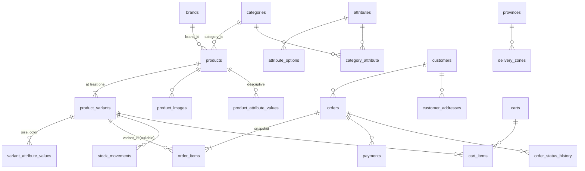

# طرح دیتابیس «بازارک» (Bazarak) — فروشگاه آنلاین برادران حکیمی

> نسخه‌ی ۰٫۳ — ۲۵ عقرب ۱۴۰۵ — **تأییدشده؛ جدول‌های مرحله‌ی ۲ و بخش ۲ب (`customers`، `categories`، `sellers`) ساخته شد.** همراه `ARCHITECTURE.md`.
> تغییر نسبت به ۰٫۲: جدول تازه‌ی **`sellers`** (فروشندگان «در بازارک بفروشید»، بخش ۳-د)؛ `customers` و `categories` جلوتر از برنامه ساخته شد (منوی دسته‌ها و ورود فروشنده به آن‌ها نیاز داشت).
> تغییر نسبت به نسخه‌ی ۰٫۱ (تصمیم صاحب پروژه): **هیچ ستون `erp_*` و هیچ جدول همگام‌سازی نداریم** (فروشگاه مستقل است)؛ ستون‌های تازه: `users.password_changed_at`، `activity_log.subject_label`، `provinces.delivery_enabled`.
> دیتابیس: `hakimi_store` (کار) و `hakimi_store_test` (تست). **کاملاً جدا از دیتابیس `hakimi` دکان**؛ هیچ جدول مشترکی نیست.

## ۱. قاعده‌ها
- فقط با migration لاراول ساخته و تغییر داده می‌شود (`database/migrations/`). migrationی که به سرور رفته ویرایش نمی‌شود. به‌روزرسانی هیچ داده‌ای را پاک نمی‌کند (ستون حذف نمی‌شود؛ اول غیرفعال، بعد با migration جدا و پشتیبان).
- InnoDB، `utf8mb4` با `utf8mb4_unicode_ci`.
- کلید اصلی `id BIGINT UNSIGNED AUTO_INCREMENT`. جدول‌هایی که در آدرس عمومی یا همگام‌سازی دیده می‌شوند `uuid CHAR(36)` یکتا دارند: کاربر پنل، دسته، جنس، نوع، عکس، مشتری، سفارش، پرداخت.
- `created_at` و `updated_at` همه جا (UTC). `deleted_at` (حذف نرم) فقط روی جنس، دسته، برند، مشتری. **سفارش و پرداخت هیچ‌وقت پاک نمی‌شود** (فقط لغو).
- پول `DECIMAL(12,2)` به افغانی. تعداد `DECIMAL(12,3)` (نمایش به عدد صحیح مگر نوع `allow_fraction` داشته باشد). نرخ پول `DECIMAL(18,6)`.
- متن چندزبانه: ستون `JSON` با کلید زبان: `{"fa": "کفش چرمی"}`؛ fallback به `fa`.
- وضعیت‌ها `VARCHAR(25)` + enum در PHP (`app/Enums`)، نه `ENUM` دیتابیس، تا افزودن مقدار migration نخواهد.
- کلید خارجی: پیش‌فرض `RESTRICT` (پاک کردن چیزی که استفاده شده ممنوع)؛ در ردیف‌های سفارش `SET NULL` برای جنس و نوع (سفارش تاریخی می‌ماند).
- **هیچ ستون `erp_*` ساخته نمی‌شود:** فروشگاه به سیستم دکان وصل نیست (ARCHITECTURE.md بخش ۸).
- جدول‌های خود لاراول (`migrations`، `sessions`، `cache`، `cache_locks`، `jobs`، `job_batches`، `failed_jobs`، `password_reset_tokens`) استاندارد می‌مانند.
- ستون‌های کمکی (`*_count`، `min_price`، `total_stock`) cache هستند و با رویداد مدل به‌روز می‌شوند؛ منبع حقیقت جدول‌های اصلی است.

## ۲. نمای کلی هسته

## ۳. جدول‌ها

### الف) کاربران پنل و دسترسی

#### `users` — کاربران پنل مدیریت (اعضای خانواده)
| ستون | نوع | توضیح |
|---|---|---|
| id, uuid | | |
| name | VARCHAR(100) | |
| phone | VARCHAR(20) UNIQUE | نرمال‌شده: `07XXXXXXXX` |
| email | VARCHAR(150) NULL UNIQUE | اختیاری |
| password | VARCHAR(255) | hash |
| role | VARCHAR(20) | `owner` / `manager` / `staff` / `editor` |
| is_active | BOOL | |
| failed_logins, locked_until | SMALLINT, DATETIME NULL | قفل ۱۵ دقیقه‌ای بعد از ۱۰ رمز اشتباه |
| password_changed_at | DATETIME NULL | خالی = رمز را کس دیگری داده؛ کاربر در اولین ورود باید رمز خودش را بگذارد |
| last_login_at | DATETIME NULL | |
| remember_token | VARCHAR(100) NULL | |
| timestamps | | |

#### `activity_log` — چه کسی چه کرد
`id`، `actor_type` VARCHAR(10) (`user`/`customer`/`system`)، `actor_id` NULL، `action` VARCHAR(50) (`auth.login`، `user.created`، `settings.updated`، `order.confirmed`…)، `subject_type` VARCHAR(50) NULL، `subject_id` BIGINT NULL، `subject_label` VARCHAR(150) NULL (نام خوانا در همان لحظه)، `changes` JSON NULL (قبل/بعد)، `ip` VARCHAR(45) NULL، `created_at`.
Index: (`subject_type`, `subject_id`)، (`actor_type`, `actor_id`, `created_at`).

### ب) مشتریان

#### `customers`
| ستون | نوع | توضیح |
|---|---|---|
| id, uuid | | |
| name | VARCHAR(100) | |
| phone | VARCHAR(20) UNIQUE | کلید اصلی شناخت مشتری |
| phone_verified_at | DATETIME NULL | بعد از پیامک واقعی |
| email | VARCHAR(150) NULL | |
| password | VARCHAR(255) NULL | مهمان ندارد |
| is_guest | BOOL | مهمان: ساخته‌شده هنگام سفارش بی رمز |
| locale | VARCHAR(5) | پیش‌فرض `fa` |
| currency_code | CHAR(3) | پیش‌فرض `AFN` |
| province_id | FK provinces NULL | |
| city, address | VARCHAR(100) NULL, TEXT NULL | آخرین آدرس (برای پر کردن خودکار) |
| notes | TEXT NULL | یادداشت مدیر (مثلاً «مشتری خوب») |
| orders_count, orders_total | INT, DECIMAL(12,2) | cache |
| is_active | BOOL | |
| last_login_at | DATETIME NULL | |
| timestamps, deleted_at | | |

#### `customer_addresses`
`id`، `customer_id` FK، `label` VARCHAR(50) (خانه/دفتر)، `recipient_name`، `recipient_phone`، `province_id` FK، `city`، `address_line` TEXT، `is_default` BOOL، timestamps.

#### `customer_otps` — کد یک‌بارمصرف (مرحله‌ی بعد؛ جدول در مرحله‌ی ۵ ساخته می‌شود)
`id`، `phone`، `code_hash`، `purpose` VARCHAR(10) (`login`/`verify`/`reset`)، `expires_at`، `attempts` TINYINT، `created_at`. Index (`phone`, `purpose`).

### د) فروشندگان («در بازارک بفروشید»)

#### `sellers` — یک ردیف برای هر مشتری‌ای که فورم فروشنده را شروع کرده
| ستون | نوع | توضیح |
|---|---|---|
| id, uuid | | |
| customer_id | FK customers UNIQUE | حساب ورود فروشنده (حذف مشتری ← حذف فروشنده) |
| status | VARCHAR(15) | `draft` / `pending` / `approved` / `rejected` / `suspended` |
| onboarding_step | TINYINT | دورترین قدمی که باز است (۱ تا ۴) |
| type | VARCHAR(15) NULL | `individual` (شخص) / `business` (دکان یا شرکت) |
| full_name, father_name | VARCHAR(100) NULL | مطابق تذکره |
| tazkira_number | VARCHAR(30) NULL UNIQUE | به‌جای کد ملی؛ بی فاصله و با ارقام انگلیسی ذخیره می‌شود (`1400-0101-12345`) |
| store_name | VARCHAR(100) NULL UNIQUE | نامی که مشتریان می‌بینند |
| business_name, license_number | VARCHAR(150), VARCHAR(50) NULL | فقط برای `business` (نمبر جواز تجارتی) |
| is_local_producer, is_social_seller, has_brand | BOOL | نشان‌های اختیاری |
| social_url, brand_name | NULL | اگر نشانش روشن است |
| category_ids | JSON NULL | دسته‌های اصلی که می‌خواهد بفروشد |
| province_id | FK provinces NULL | |
| city, address, phone | NULL | آدرس دکان؛ تلفن دکان اگر با شماره‌ی حساب فرق دارد |
| terms_accepted_at, submitted_at | DATETIME NULL | |
| reviewed_by | FK users NULL | مدیری که تأیید/رد کرد |
| reviewed_at | DATETIME NULL | |
| review_note | TEXT NULL | دلیل رد یا بستن — **به فروشنده نشان داده می‌شود** |
| admin_notes | TEXT NULL | یادداشت داخلی مدیر |
| timestamps | | |

Index: (`status`, `submitted_at`).

### ر) کمیسیون و حساب فروشندگان (۲۶ عقرب ۱۴۰۵)

- `categories.commission_rate` DECIMAL(5,2) NULL — خالی = از بالادست، بعد `marketplace.default_commission_rate`.
- `sellers` + `approved_at`، `settlement_cycle` (`weekly`/`biweekly`/`monthly`)، `free_pickup_until` DATE، `incentives_applied_at`.

#### `seller_commission_rates` — نرخ ویژه‌ی فروشنده
`id`، `seller_id` FK، `category_id` FK NULL (خالی = همه)، `rate` DECIMAL(5,2)، `starts_at`/`ends_at` NULL، `reason` (`manual`/`incentive.social`/`incentive.local`)، `note`، `created_by` FK users، timestamps. Index (`seller_id`, `starts_at`, `ends_at`).

#### `commission_entries` — سند مالی هر فروش یا برگشت (ویرایش/حذف ندارد)
| ستون | نوع | توضیح |
|---|---|---|
| id, uuid | | |
| idempotency_key | VARCHAR(120) UNIQUE | `order_item:15:sale`، `order_return:7:reversal` — هیچ فروشی دو بار ثبت نمی‌شود |
| seller_id | FK NULL | خالی = فروش خود بازارک |
| kind | VARCHAR(10) | `sale` / `reversal` |
| source_type, source_id | | `order_item` / `order_return` / `manual` |
| category_id | FK NULL | |
| gross_amount | DECIMAL(12,2) | مبلغ جنس **بی کرایه** (برگشت منفی) |
| commission_rate, rate_source | DECIMAL(5,2), VARCHAR(15) | نرخ همان لحظه و منبعش (`seller`/`category`/`default`/`platform`) |
| commission_amount, seller_amount | DECIMAL(12,2) | سهم بازارک، سهم فروشنده |
| reverses_id | FK self NULL | سند فروشی که برگشت داده شد |
| occurred_at, created_by, created_at | | |

#### `seller_transactions` — دفتر حساب فروشنده (ویرایش/حذف ندارد)
`id`، `seller_id`، `type` (`earning`/`reversal`/`payout`/`adjustment`)، `amount` (مثبت = طلب فروشنده زیاد شد)، `balance_after`، `commission_entry_id` UNIQUE NULL، `settlement_id` UNIQUE NULL، `description`، `created_by`، `created_at`.

#### `seller_settlements` — تسویه با فروشنده
`id`، `uuid`، `seller_id`، `amount`، `method` (`cash`/`hesabpay`/`bank_transfer`)، `reference`، `period_from`/`period_to`، `notes`، `paid_at`، `created_by`، timestamps.

**`products.seller_id` در مرحله‌ی ۳-۲ ساخته شد** (خالی = جنس خود بازارک). **در مرحله‌ی ۴ اضافه می‌شود:** روی `order_items`: `seller_id`، `commission_rate`، `commission_amount`، `seller_amount`، `commission_entry_id` (کپی نرخ و مبلغ همان لحظه).

### پ) کاتالوگ

#### `categories`
| ستون | نوع | توضیح |
|---|---|---|
| id, uuid | | |
| parent_id | FK self NULL | چندسطحی |
| slug | VARCHAR(150) UNIQUE | فارسی مجاز |
| name | JSON | `{"fa": "کفش و بوت"}` |
| description | JSON NULL | |
| image_path, icon | VARCHAR(255) NULL, VARCHAR(50) NULL | کاشی صفحه‌ی اصلی |
| position | INT | ترتیب |
| depth, path | TINYINT, VARCHAR(255) | `path` = شناسه‌ها با `/` («1/5/12») برای جستجوی زیرشاخه‌ها |
| is_active, show_in_menu | BOOL | |
| meta_title, meta_description | JSON NULL | |
| products_count | INT | cache |
| timestamps, deleted_at | | |

Index: `parent_id`، (`is_active`, `position`).

#### `brands`
`id`، `slug` UNIQUE، `name` VARCHAR(100)، `logo_path` NULL، `is_active`، `position`، timestamps، `deleted_at`.

#### `attributes` — مشخصه‌ها (سایز، رنگ، RAM، …)
| ستون | نوع | توضیح |
|---|---|---|
| id | | |
| code | VARCHAR(50) UNIQUE | `size`, `color`, `ram`, `storage`, `condition`… |
| name | JSON | |
| type | VARCHAR(15) | `select` / `multiselect` / `text` / `number` / `boolean` |
| unit | VARCHAR(20) NULL | «GB»، «اینچ» |
| is_variant | BOOL | نوع‌ساز (سایز، رنگ، حافظه) |
| is_filterable | BOOL | در فیلتر دسته |
| show_in_specs | BOOL | در جدول مشخصات |
| position, is_active | | |
| timestamps | | |

#### `attribute_options` — گزینه‌های هر مشخصه
`id`، `attribute_id` FK، `slug` VARCHAR(100)، `value` JSON (`{"fa":"سیاه"}`)، `color_hex` CHAR(7) NULL، `position`، `is_active`، timestamps. UNIQUE (`attribute_id`, `slug`).

#### `category_attribute` — کدام مشخصه در کدام دسته
`id`، `category_id` FK، `attribute_id` FK، `is_required` BOOL، `position`. UNIQUE (`category_id`, `attribute_id`). زیردسته به ارث می‌برد (در سرویس).

#### `products`
| ستون | نوع | توضیح |
|---|---|---|
| id, uuid | | |
| category_id | FK | |
| brand_id | FK NULL | |
| slug | VARCHAR(200) UNIQUE | |
| name | JSON | |
| short_description, description | JSON NULL | توضیح کوتاه برای کارت؛ بلند برای صفحه |
| status | VARCHAR(10) | `draft` / `active` / `inactive` |
| is_featured | BOOL | «پیشنهاد ویژه» |
| has_variants | BOOL | |
| seller_id | FK sellers NULL | **خالی = جنس خود بازارک** (کمیسیون ندارد)؛ پر = جنس فروشنده‌ی تأییدشده |
| min_price, max_price | DECIMAL(12,2) NULL | cache از نوع‌های فعال |
| min_compare_price | DECIMAL(12,2) NULL | قیمت قبلی ارزان‌ترین نوع (نشان تخفیف روی کارت) |
| total_stock | DECIMAL(12,3) | cache |
| search_text | TEXT | نرمال‌شده؛ FULLTEXT |
| views_count, sold_count | INT | |
| meta_title, meta_description | JSON NULL | |
| published_at | DATETIME NULL | |
| created_by, updated_by | FK users NULL | |
| timestamps, deleted_at | | |

Index: (`status`, `published_at`)، `category_id`، `brand_id`، `is_featured`، FULLTEXT (`search_text`).

#### `product_attribute_values` — مشخصات توصیفی جنس
`id`، `product_id` FK، `attribute_id` FK، `attribute_option_id` FK NULL، `value_text` VARCHAR(255) NULL، `value_number` DECIMAL(18,4) NULL، `value_bool` BOOL NULL.
UNIQUE (`product_id`, `attribute_id`, `attribute_option_id`). Index (`attribute_id`, `attribute_option_id`) برای فیلتر.

#### `product_variants` — نوع‌ها (هر جنس حداقل یکی)
| ستون | نوع | توضیح |
|---|---|---|
| id, uuid | | |
| product_id | FK | |
| sku | VARCHAR(60) UNIQUE | خودکار: `HK-000123-42-BLK` |
| barcode | VARCHAR(64) NULL | |
| label | VARCHAR(100) NULL | خودکار از گزینه‌ها: «۴۲ / سیاه» |
| price | DECIMAL(12,2) | به افغانی |
| compare_at_price | DECIMAL(12,2) NULL | قیمت قبلی (تخفیف) |
| cost_price | DECIMAL(12,2) NULL | پنهان؛ برای گزارش سود |
| stock_qty | DECIMAL(12,3) | موجودی برای فروش آنلاین |
| reserved_qty | DECIMAL(12,3) | در سفارش‌های باز |
| low_stock_threshold | DECIMAL(12,3) NULL | هشدار |
| allow_backorder | BOOL | فروش با موجودی صفر (`allow_fraction` ساخته نشد؛ موجودی DECIMAL است و اگر روزی لازم شد اضافه می‌شود) |
| weight_grams | INT NULL | برای کرایه‌ی آینده |
| is_default, is_active | BOOL | |
| position | INT | |
| image_id | FK product_images NULL | عکس اختصاصی نوع (مثلاً رنگ) |
| timestamps | | |

Index: `product_id`، (`is_active`)، `barcode`.

#### `variant_attribute_values` — سایز/رنگ هر نوع
`id`، `variant_id` FK، `attribute_id` FK، `attribute_option_id` FK. UNIQUE (`variant_id`, `attribute_id`). Index (`attribute_option_id`).

#### `product_images`
`id`، `uuid`، `product_id` FK، `variant_id` FK NULL، `path` VARCHAR(255) (اصل)، `alt` JSON NULL، `position`، `is_primary` BOOL، `width`، `height`، `sizes` JSON (مسیر WebP ۳۰۰/۶۰۰/۱۲۰۰)، `avif_sizes` JSON NULL (نسخه‌ی AVIF همان اندازه‌ها؛ خالی اگر سرور AVIF نداشت)، `file_size` INT، timestamps. Index (`product_id`, `position`).

#### `product_relations` — جنس مرتبط / لوازم
`id`، `product_id` FK، `related_product_id` FK، `kind` VARCHAR(15) (`related` / `accessory`)، `position`. UNIQUE (`product_id`, `related_product_id`).

#### `slug_redirects`
`id`، `type` VARCHAR(15) (`product`/`category`/`page`)، `old_slug` VARCHAR(200)، `target_id` BIGINT، `created_at`. UNIQUE (`type`, `old_slug`).

### ت) قیمت، تخفیف، پول

#### `currencies`
`code` CHAR(3) PK، `name` JSON، `symbol` VARCHAR(10)، `rate_to_afn` DECIMAL(18,6) (یک واحد = چند افغانی)، `decimals` TINYINT، `is_default`، `is_active`، `position`، timestamps. داده‌ی اولیه: `AFN` (۱، پیش‌فرض)، `USD` (غیرفعال).

#### `promotions` — کمپاین تخفیف
`id`، `name` VARCHAR(100)، `badge` JSON NULL («حراج عید»)، `type` VARCHAR(10) (`percent`/`fixed`)، `value` DECIMAL(12,2)، `scope` VARCHAR(10) (`all`/`category`/`brand`/`product`/`variant`)، `starts_at`، `ends_at`، `priority` INT، `is_active`، `created_by`، timestamps. Index (`is_active`, `starts_at`, `ends_at`).

#### `promotion_targets`
`id`، `promotion_id` FK، `target_type` VARCHAR(10)، `target_id` BIGINT. UNIQUE (`promotion_id`, `target_type`, `target_id`).

#### `coupons`
`id`، `code` VARCHAR(30) UNIQUE، `type`، `value`، `min_order_total` DECIMAL NULL، `max_discount` DECIMAL NULL، `max_uses` INT NULL، `max_uses_per_customer` INT NULL، `used_count` INT، `starts_at`، `ends_at`، `is_active`، timestamps.

#### `coupon_redemptions`
`id`، `coupon_id` FK، `order_id` FK، `customer_id` FK NULL، `amount` DECIMAL(12,2)، `created_at`.

### ث) تحویل

#### `provinces` — ۳۴ ولایت (داده‌ی اولیه)
`id`، `code` VARCHAR(10) UNIQUE (کد ISO 3166-2:AF: `KAB`، `HER`، `GHA`…)، `name` JSON، `position`، `is_active`، `delivery_enabled` BOOL (آیا فعلاً به این ولایت جنس می‌رسانیم؛ شروع: فقط کابل، بقیه «زیر کار است»).

> **ساخته شد (۲۶ عقرب ۱۴۰۵) با طرح تازه‌ی کرایه «روز تحویل + وزن»:** `delivery_zones` (name JSON، `province_id` NULL یکتا، `is_active`، `position`، `cutoff_hour` ساعت قطع سفارش، `days_off` JSON روزهای هفته‌ی ISO، `default_item_weight_grams`، `max_weight_grams` NULL)، `delivery_slots` (`zone_id`، `day_rank` ۱ = زودترین روز، `fee` DECIMAL(12,2)، `is_active`)، `delivery_weight_tiers` (`zone_id`، `up_to_grams` NULL = سنگین‌تر از همه، `extra_fee`، `position`). ستون‌های جدول قدیمی زیر (کرایه‌ی ثابت، `cod_fee`، `free_over`، `eta_days`) **ساخته نشد**؛ «روز + وزن» جایش را گرفت و «رایگان بالای مبلغ» اگر خواسته شد بعداً با تصمیم جدا اضافه می‌شود. در `orders` (مرحله‌ی ۴): `delivery_zone_id`، `delivery_date`، `delivery_fee` (کاپی همان لحظه) و `delivery_weight_grams`.

#### (طرح اولیه‌ی قدیمی؛ جایگزین شد) `delivery_zones` — منطقه‌ی تحویل و کرایه
| ستون | نوع | توضیح |
|---|---|---|
| id | | |
| name | JSON | «کابل شهر»، «بقیه‌ی کشور» |
| province_id | FK NULL | NULL = هر ولایتی که منطقه‌ی خودش را ندارد |
| city_match | VARCHAR(100) NULL | اگر پر: فقط این شهر/ولسوالی |
| fee | DECIMAL(12,2) | کرایه |
| cod_fee | DECIMAL(12,2) | اضافه برای پرداخت هنگام تحویل |
| free_above | DECIMAL(12,2) NULL | رایگان بالای این مبلغ |
| eta_days_min, eta_days_max | TINYINT | زمان تقریبی |
| priority | INT | انتخاب: اول ولایت+شهر، بعد ولایت، بعد NULL |
| is_active | BOOL | |
| timestamps | | |

### ج) سبد

#### `carts`
**ساخته شد (۴-۱):** `id`، `token` CHAR(36) UNIQUE (کوکی مهمان)، `customer_id` FK NULL **UNIQUE** (یک سبد برای هر مشتری؛ حذف مشتری ← حذف سبد)، `expires_at` (۳۰ روز از آخرین تغییر؛ پاک‌سازی شبانه‌ی سبدهای کهنه بعداً)، timestamps. بی `currency_code` (همیشه افغانی).

#### `cart_items`
**ساخته شد (۴-۱):** `id`، `cart_id` FK، `variant_id` FK (حذف نوع ← حذف خط)، `qty` **INT** بدون علامت (عدد صحیح؛ جنس کسری فعلاً نیست)، timestamps. UNIQUE (`cart_id`, `variant_id`).

### چ) سفارش، پرداخت، موجودی

> **۱ قوس ۱۴۰۵: طرح قدیمی زیر (تک‌جدولی) جایگزین می‌شود** با «طرح v2» (بخش چ-۲ پایین همین فایل: سفارش والد + سفارش هر فروشنده، خریدار ≠ گیرنده، پرداخت و بازپرداخت جدا). تا تأیید صاحب پروژه (`docs/ASSESSMENT_AND_PLAN.md`) هیچ‌کدام migrate نشده است. جدول‌های `payment_methods`، `stock_movements`، `order_status_history` اینجا مبنای v2 هستند، با تغییرهای ذکر‌شده.

#### `orders`
| ستون | نوع | توضیح |
|---|---|---|
| id, uuid | | آدرس عمومی با uuid |
| number | VARCHAR(20) UNIQUE | `HS-000123` |
| customer_id | FK NULL | مهمان هم رکورد مشتری دارد (`is_guest`) |
| status | VARCHAR(15) | `pending`/`confirmed`/`processing`/`shipped`/`delivered`/`cancelled`/`returned` |
| payment_status | VARCHAR(25) | `unpaid`/`pending_confirmation`/`partial`/`paid`/`failed`/`refunded` |
| payment_method_code | VARCHAR(30) | از `payment_methods.code` |
| currency_code, exchange_rate | CHAR(3), DECIMAL(18,6) | همیشه AFN و ۱ در نسخه‌ی اول |
| subtotal | DECIMAL(12,2) | جمع خط‌ها بعد از تخفیف خطی |
| discount_total | DECIMAL(12,2) | کوپن |
| coupon_id, coupon_code | FK NULL, VARCHAR(30) NULL | |
| shipping_fee, cod_fee | DECIMAL(12,2) | کاپی از منطقه |
| total | DECIMAL(12,2) | مجموع نهایی |
| paid_total | DECIMAL(12,2) | جمع پرداخت‌های تأییدشده |
| delivery_zone_id | FK NULL | |
| recipient_name, recipient_phone | VARCHAR(100), VARCHAR(20) | |
| province_id | FK | |
| city, address_line | VARCHAR(100), TEXT | |
| customer_note, admin_note | TEXT NULL | |
| source | VARCHAR(10) | `web` / `admin` / `whatsapp` |
| needs_stock_check | BOOL | جنس با backorder؛ مدیر پیش از تأیید با دکان چک می‌کند |
| locale | VARCHAR(5) | |
| ip, user_agent | VARCHAR(45), VARCHAR(255) NULL | |
| placed_at | DATETIME | |
| confirmed_at, shipped_at, delivered_at, cancelled_at | DATETIME NULL | |
| cancel_reason | VARCHAR(255) NULL | |
| cancelled_by | FK users NULL | |
| timestamps | | |

Index: (`status`, `placed_at`)، `customer_id`، `recipient_phone`، `payment_status`، (`number`, `recipient_phone`) برای پیگیری.

#### `order_items` — خط‌های سفارش (snapshot)
`id`، `order_id` FK، `variant_id` FK NULL (SET NULL)، `product_id` FK NULL (SET NULL)، `product_name` VARCHAR(200) (متن دری هنگام سفارش)، `variant_label` VARCHAR(100) NULL، `sku` VARCHAR(60)، `image_path` NULL، `unit_price` DECIMAL(12,2)، `compare_at_price` NULL، `discount_amount` DECIMAL(12,2)، `qty` DECIMAL(12,3)، `line_total` DECIMAL(12,2)، timestamps. Index `order_id`.

#### `order_status_history`
`id`، `order_id` FK، `kind` VARCHAR(10) (`order`/`payment`)، `from_status`، `to_status`، `user_id` FK NULL (NULL = مشتری یا سیستم)، `note` TEXT NULL، `created_at`. Index (`order_id`, `created_at`).

#### `payment_methods` — روش‌های پرداخت (قابل تنظیم از پنل)
| ستون | نوع | توضیح |
|---|---|---|
| id | | |
| code | VARCHAR(30) UNIQUE | `cod`، `hesabpay`، `bank_transfer`… |
| name, description | JSON | نام و توضیح برای مشتری در تسویه |
| instructions | JSON NULL | بعد از ثبت نشان داده می‌شود (شماره‌ی حساب، نام گیرنده‌ی حواله) |
| type | VARCHAR(20) | `cod` / `manual_transfer` / `gateway` |
| driver | VARCHAR(50) NULL | کلاس درایور برای `gateway` |
| fee | DECIMAL(12,2) | |
| min_total, max_total | DECIMAL NULL | |
| config | JSON NULL | تنظیمات غیرمحرمانه؛ **کلید و رمز اینجا نه** (فقط `.env`) |
| is_active, position | | |
| timestamps | | |

#### `payments`
`id`، `uuid`، `order_id` FK، `method_code` VARCHAR(30)، `amount` DECIMAL(12,2)، `status` VARCHAR(15) (`pending`/`confirmed`/`failed`/`refunded`)، `reference` VARCHAR(100) NULL (شماره‌ی حواله / مرجع درگاه)، `payer_name` NULL، `gateway_payload` JSON NULL، `confirmed_by` FK users NULL، `confirmed_at` NULL، `note` NULL، timestamps. Index `order_id`، `reference`.

#### `stock_movements` — دفتر حرکت موجودی آنلاین
`id`، `variant_id` FK، `type` VARCHAR(15) (`adjust`/`reserve`/`release`/`sale`/`return`)، `qty_delta` DECIMAL(12,3)، `stock_after`، `reserved_after`، `reference_type` VARCHAR(30) NULL، `reference_id` BIGINT NULL، `user_id` FK NULL، `note` NULL، `created_at`. Index (`variant_id`, `created_at`).

### چ-۲) طرح v2 — سفارش چندفروشنده، پرداخت، بازپرداخت (**تأیید شد ۲ قوس ۱۴۰۵**؛ بخش اول migrate شد)

> **وضعیت migrate:** `orders`، `seller_orders` (با ستون‌های صورت مالی)، `order_items` (با کپی کمیسیون؛ بی `commission_rule_id` FK)، `order_status_history`، `stock_movements`، `payment_methods`، `collection_points`، `payments` ← **ساخته شد** (`2026_11_22_000100/000200`). `orders.delivery_code` (`2026_11_23_000100`) و `payments.delivery_code_verified` (`2026_11_23_000200`) هم اضافه شد. **نقش `courier`** هم آمد (ستون `users.role` از اول VARCHAR است و migration نخواست). ستون‌های ساخته‌نشده‌ی این بخش (کوپن/UTM/آدرس صورتحساب در `orders`، `exchange_rate`) و جدول‌های `payment_events`، `payment_allocations`، `commission_rules`، `seller_settlement_items`، `refunds`، `refund_items`، `order_returns*`، ستون‌های تازه‌ی `seller_transactions`/`seller_settlements`/`sellers` و `activity_log.reason` و نقش `courier` ← **بعداً** در مرحله‌ی خودشان.

قاعده‌ها: پول `DECIMAL(12,2)`؛ تعداد `UNSIGNED INT`؛ UUID برای سفارش، سفارش فروشنده، پرداخت، بازپرداخت؛ همه InnoDB؛ ردیف‌های مالی ویرایش و حذف ندارند (فقط سند معکوس).

#### `orders` — سفارش والد (یک تسویه، یک شماره‌ی عددی `100000001`)
| ستون | نوع | توضیح |
|---|---|---|
| id, uuid, number | | آدرس عمومی با uuid؛ `number` یکتا. **از ۲ قوس ۱۴۰۵ فقط عدد** (`Order::NUMBER_BASE + id`، خواست صاحب پروژه)؛ سفارش‌های قدیمی `HS-000123` ماندند و پیگیری هر دو شکل را قبول می‌کند |
| **delivery_code** | VARCHAR(10) NULL | کد تحویل پنج‌رقمی؛ مشتری هنگام گرفتن جنس می‌گوید (migration `2026_11_23_000100`؛ برای سفارش‌های موجود هم ساخته شد). بررسی‌اش با نقش پیک در مرحله‌ی ۳ |
| customer_id | FK NULL | حساب خریدار؛ مهمان: خالی (بی ردیف مشتری ساختگی) |
| **purchaser_name, purchaser_phone, purchaser_email** | VARCHAR | خریدار؛ تلفن E.164 یا افغانی؛ ایمیل برای خریدار خارج لازم |
| purchaser_country | CHAR(2) | `AF` پیش‌فرض |
| billing_address | JSON NULL | فقط اگر درگاه بخواهد؛ دسترسی محدود |
| **is_gift** | BOOL | «برای کس دیگری می‌خرم» |
| **recipient_name, recipient_phone** | VARCHAR | گیرنده؛ تلفن افغانی |
| province_id, city, **district**, address_line, **delivery_instructions** | | آدرس تحویل (خالی برای حضوری) |
| status | VARCHAR(15) | `pending/confirmed/processing/shipped/delivered/cancelled/returned` (محاسبه‌شده از سفارش‌های فروشنده؛ ثبت‌شده برای فیلتر) |
| payment_status | VARCHAR(25) | `unpaid/awaiting_collection/pending/paid/failed/partially_refunded/refunded` |
| payment_method_code | VARCHAR(30) | |
| currency_code, exchange_rate | CHAR(3), DECIMAL(18,6) | AFN و ۱ |
| subtotal, discount_total, delivery_fee, payment_fee, total | DECIMAL(12,2) | `total = subtotal − discount_total + delivery_fee + payment_fee` |
| paid_total, refunded_total | DECIMAL(12,2) | جمع پرداخت‌های تأییدشده/بازپرداخت‌شده؛ **فقط سرویس مالی عوض می‌کند** |
| delivery_method, delivery_mode | VARCHAR | `delivery`/`pickup`؛ `consolidated` (شروع)/`per_seller` |
| delivery_zone_id, delivery_date, delivery_weight_grams | | کپی از `DeliveryCalculator` |
| coupon_id, coupon_code | NULL | مرحله‌ی ۹ |
| customer_note, admin_note | TEXT NULL | |
| source, utm_source, utm_medium, utm_campaign | VARCHAR NULL | `web/admin/whatsapp`؛ ردیابی بازاریابی |
| needs_stock_check | BOOL | |
| locale, ip, user_agent | | |
| placed_at, confirmed_at, shipped_at, delivered_at, cancelled_at | DATETIME NULL | |
| cancel_reason, cancelled_by | | |
Index: (`status`,`placed_at`)، `customer_id`، `purchaser_phone`، `recipient_phone`، `payment_status`، `delivery_date`.

#### `seller_orders` — سفارشِ هر فروشنده
`id`، `uuid`، `order_id` FK (cascade)، `number` (`HS-000123-1`، یکتا)، `seller_id` FK NULL (**خالی = جنس خود بازارک**)، `status` (همان ۷ وضعیت)، `subtotal`، `commission_total`، `seller_total`، `delivery_fee_share` (۰ در `consolidated`)، `handover_at` (فروشنده جنس را به بازارک داد)، `shipped_at`، `delivered_at`، `cancelled_at`، `cancel_reason`، `seller_note`، `assigned_courier_id` FK users NULL، timestamps. Index (`seller_id`,`status`)، `order_id`.

#### `order_items` (جدید؛ جایگزین بخش قدیمی)
`id`، `order_id` FK، `seller_order_id` FK، `variant_id/product_id/seller_id/category_id` (NULL، SET NULL)، **snapshot:** `product_name`، `variant_label`، `sku`، `image_path`، `unit_price`، `compare_at_price`، `discount_amount`، `qty` UNSIGNED INT، `line_total`؛ **مالی (هنگام تحویل+پول):** `commission_rate`، `commission_amount`، `seller_amount`، `commission_entry_id` FK NULL؛ `qty_cancelled`، `qty_returned`.

#### `order_status_history` (تغییر: موضوع عمومی)
`id`، `subject_type` (`order/seller_order/payment/refund/return`)، `subject_id`، `from_status`، `to_status`، `user_id` NULL (خالی = مشتری/سیستم)، `note`، `created_at`. Index (`subject_type`,`subject_id`,`created_at`).

#### `payment_methods` (تغییر)
`code` یکتا (**MVP: فقط `cod`، `cash_point`، `hesabpay`**؛ `manual_transfer` و `hesabpay_intl` طبق تصمیم ۱ قوس ۱۴۰۵ ساخته نمی‌شود)، `name/description/instructions` JSON، `type` (`cod/cash_point/gateway`؛ مقدار `manual_transfer` فقط اگر روزی تصمیم تازه شد)، `driver` NULL، **`audience`** JSON (`["domestic"]`/`["international"]`/هر دو)، `fee`، `min_total/max_total`، `config` JSON NULL (غیرمحرمانه؛ کلید فقط `.env`)، `is_active`، `position`.

#### `payments` — هر تلاش یا دریافت پول
| ستون | توضیح |
|---|---|
| id, uuid | |
| order_id FK، seller_order_id FK NULL | خالی = کل سفارش (حالت یکپارچه) |
| method_code, provider NULL | `cod/cash_point/hesabpay` |
| amount, fee_amount, currency_code | مبلغ مورد انتظار؛ کارمزد درگاه (از جواب درگاه) |
| status | `awaiting_collection/pending/paid/failed/refunded/partially_refunded` |
| failed_reason | `declined/expired/cancelled/mismatch/…` |
| idempotency_key | **UNIQUE** |
| provider_reference | NULL؛ **UNIQUE** با `provider` |
| attempt_no, expires_at, paid_at | |
| amount_received | پول نقدِ واقعی گرفته‌شده |
| collected_by FK users NULL، collected_at_type (`door`/`point`)، collection_point_id FK NULL، collected_at | چه کسی، کجا (دم در توسط پیک / نمایندگی)، کی (تاریخ و ساعت) |
| courier_cash_status | `held_by_courier`/`handed_over` NULL (پولِ دست پیک تا تحویل به صندوق)؛ `handed_over_to`، `handed_over_at` |
| receipt_number | **UNIQUE** NULL (`RC-` + ۱۰۰۰۰۰ + شناسه ← `RC-100001`؛ هنگام «پول رسید» ساخته می‌شود) |
| **delivery_code_verified** | BOOL، پیش‌فرض ۰ (migration `2026_11_23_000200`): کد تحویل مشتری هنگام گرفتن پول بررسی و درست بود — سندِ تحویلِ درست روی خود رسید |
| payer_name, transfer_reference, receipt_path | حواله/رسید (**MVP ساخته نمی‌شود**؛ تصمیم ۱ قوس ۱۴۰۵) |
| note، timestamps | |

#### `payment_events` — رویدادهای درگاه و دستی (فقط افزودن)
`id`، `payment_id` FK NULL، `provider`، `event_id` (**UNIQUE** با provider)، `type`، `payload` JSON (بی هدر کلید و بی داده‌ی کارت)، `signature_valid` BOOL، `processed_at` NULL، `error` NULL، `created_at`.

#### `collection_points` — نمایندگی‌ها / نقطه‌های دریافت نقد و تحویل حضوری
`id`، `name` JSON، `type` (`office/agent`)، `province_id`، `city`، `address`، `phone`، `hours` JSON، `instructions` JSON، `user_id` FK NULL (مسئول)، `is_active`، `position`. از پنل ساخته می‌شود؛ «دفتر مرکزی» اولین ردیف است. (تصمیم ۱ قوس ۱۴۰۵: نمایندگی‌ها از همان اول؛ نه فقط دفتر مرکزی.)

#### `refunds` — بازپرداخت پول
`id`، `uuid`، `order_id`، `payment_id`، `seller_order_id` NULL، `amount`، `reason`، `status` (`requested/approved/processing/completed/failed/rejected`)، `method` (`manual/gateway`)، `provider_reference` NULL، `requested_by`، `approved_by`، `completed_at`، `note`. **`completed` فقط بعد از تأیید واقعی.**

#### `order_returns`، `order_return_items` — برگشت جنس
`order_returns`: `id`، `uuid`، `order_id`، `seller_order_id`، `status` (`requested/approved/received/rejected/closed`)، `reason`، `received_by`، `closed_at`. `order_return_items`: `return_id`، `order_item_id`، `qty`، `condition` (`resellable/damaged`)، `restock` BOOL.

#### `stock_movements` — همان طرح قبلی (بدون تغییر)

#### مالی — موجود و تغییر
- `commission_entries`، `seller_transactions`، `seller_settlements`: بی تغییر.
- **`commission_rules`** (جدید، جایگزین تدریجی `categories.commission_rate` + `seller_commission_rates`؛ migration با کپی داده): `scope` (`product/seller_category/seller/category/global`)، `product_id/seller_id/category_id` NULL، `type` (`percent/fixed`)، `rate`، `fixed_amount`، `starts_at/ends_at`، `reason`، `note`، `created_by`. قید: هم‌پوشانی بازه‌ها برای یک هدف ممنوع (در سرویس + تست). اولویت: `docs/COMMISSION_AND_SELLER_SETTLEMENT.md` بخش ۲.
- **`activity_log.reason`** TEXT NULL (دلیل عمل‌های مالی)؛ `activity_log.ip` موجود.
- **`users.role`**: مقدار تازه `courier` (پیک).
- `customers`: بدون تغییر (مهمان ردیف ندارد). **بعد از OTP:** سفارش‌های مهمان با شماره‌ی تأییدشده به حساب وصل می‌شوند.

#### تکمیل ۱ قوس ۱۴۰۵ — تخصیص مالی چندفروشنده (`docs/COMMISSION_AND_SELLER_SETTLEMENT.md`)
- **`orders.payment_status`** مقدار تازه `partially_paid` (فقط سفارش والد: بعضی سفارش‌های فروشنده پرداخت شده، بعضی نه).
- **`seller_orders`** + `payment_status` (`unpaid/awaiting_collection/pending/paid/failed/partially_refunded/refunded`) و **صورت مالی جدا:** `gross_subtotal`، `seller_discount_total`، `platform_discount_total`، `customer_paid_products`، `commissionable_amount`، `commission_total`، `delivery_fee`، `delivery_fee_payee` (`platform/seller`)، `gateway_fee_allocated`، `gateway_fee_charged_to_seller`، `refund_adjustments`، `other_deductions`، `seller_payable` (همگی `DECIMAL(12,2)`؛ معادله‌ها در سند کمیسیون بخش ۳؛ تست).
- **`order_items`** + `seller_discount`، `platform_discount`؛ **کپی قاعده هنگام ثبت سفارش:** `commission_rule_id` FK NULL، `commission_type` (`percent/fixed`)، `commission_rate`، `rate_source` (`product/category/seller/global/exception/platform`)، `commission_amount`، `seller_amount` (ثابت؛ ثبت دفتر از همین‌ها می‌خواند).
- **`commission_rules`** + `is_exception` BOOL (استثنا/تبلیغاتی با تاریخ پایان؛ بر همه غلبه می‌کند). ترتیب: `marketplace.commission_priority` (پیش‌فرض `product,category,seller,global`).
- **`payment_allocations`** — تخصیص پول گرفته‌شده: `id`، `payment_id` FK، `seller_order_id` FK NULL (خالی = سطح سفارش)، `component` (`products/delivery/payment_fee/gateway_fee`)، `amount`، `created_at`. **UNIQUE** (`payment_id`,`seller_order_id`,`component`). مجموع اجزای دریافتی = `payments.amount` (قید در سرویس + تست).
- **`seller_transactions`** + `order_id`، `seller_order_id`، `reference` **UNIQUE**، `gross_amount`، `commission_amount`، `refund_adjustment`، `other_adjustment`، `net_amount`، `settlement_status` (`pending/eligible_for_settlement/partially_settled/settled/adjusted`)، `settled_amount`، `occurred_at`.
- **`seller_settlement_items`** — `settlement_id`، `transaction_id`، `amount`؛ تسویه‌ی جزئی؛ مجموع هر ردیف دفتر ≤ `net_amount`.
- **`seller_settlements`** + `status` (`draft/paid/failed`)؛ ردیف `payout` در دفتر فقط با `paid` و مرجع انتقال.
- **`refund_items`** — `refund_id`، `order_item_id`، `qty`، `amount`، `commission_reversed`.
- **`sellers`** + `payment_fee_policy` (`platform` پیش‌فرض / `seller`) و `payment_fee_agreed_at`.
- تنظیمات بازارگاه: `marketplace.settlement_hold_days` (۰)، `marketplace.commission_priority`، `marketplace.platform_discount_cap_by_commission` (اختیاری).

#### migration‌های لازم (به ترتیب پیشنهادی)
۱) `orders` + `seller_orders` (با ستون‌های صورت مالی) + `order_items` (با کپی کمیسیون) + `order_status_history` + `stock_movements`؛ ۲) `payment_methods` + `payments` + `payment_events` + `payment_allocations` + `collection_points`؛ ۳) ~~`users.role` (courier)~~ ✓ (۲ قوس ۱۴۰۵؛ ستون متنی بود و فقط `UserRole::Courier` اضافه شد) + `activity_log.reason`؛ ۴) `commission_rules` (+ انتقال داده) + تغییر `seller_transactions` + `seller_settlement_items` + `seller_settlements.status` + `sellers.payment_fee_policy`؛ ۵) `refunds` + `refund_items` + `order_returns*`. هیچ‌کدام داده‌ی موجود را پاک نمی‌کند.

### ح) محتوا و تنظیمات

#### `banners`
`id`، `title` JSON NULL، `subtitle` JSON NULL، `image_path`، `mobile_image_path` NULL، `link_url` VARCHAR(255) NULL، `placement` VARCHAR(30) (`home_hero`/`home_strip`/`category_top`)، `position`، `starts_at` NULL، `ends_at` NULL، `is_active`، `clicks_count` INT، timestamps.

#### `home_sections` — بخش‌های صفحه‌ی اصلی (ترتیب و محتوا از پنل)
`id`، `type` VARCHAR(30) (`categories`/`featured`/`new`/`bestsellers`/`promotion`/`category_products`/`custom_html`)، `title` JSON NULL، `config` JSON (مثلاً `category_id`، تعداد)، `position`، `is_active`، timestamps.

#### `pages` — صفحه‌های ثابت
`id`، `slug` UNIQUE، `title` JSON، `body` JSON (HTML ساده از ویرایشگر)، `is_active`، `show_in_footer`، `position`، `meta_title` NULL، `meta_description` NULL، timestamps.

#### `settings`
`key` VARCHAR(100) PK، `value` JSON، `group` VARCHAR(30)، `updated_by` NULL، `updated_at`. کلیدها (نمونه): `store.name`، `store.phone`، `store.whatsapp`، `store.address`، `store.email`، `store.logo`، `store.currency`، `store.tagline`، `store.is_open`، `order.min_total`، `seo.default_title`.

### خ) اعلان‌ها

#### `notifications_log`
`id`، `channel` VARCHAR(10) (`sms`/`email`/`whatsapp`)، `recipient` VARCHAR(150)، `template` VARCHAR(50)، `message` TEXT، `status` VARCHAR(10) (`queued`/`sent`/`failed`/`logged`)، `provider` VARCHAR(30) NULL، `provider_ref` NULL، `error` NULL، `order_id` FK NULL، `customer_id` FK NULL، `sent_at` NULL، `created_at`.

### ذ) جدول‌های آینده (حالا ساخته نمی‌شوند)
`reviews` (نظر و امتیاز)، `wishlists`، `return_requests` (درخواست مرجوعی مشتری)، `shipments` (مرسوله، دریور، موتر)، ستون `seller_id` روی `products`/`order_items` و جدول‌های کمیسیون و تسویه‌ی فروشنده (پنل فروشنده؛ بعد از تصمیم صاحب پروژه)، `product_slugs` چندزبانه.

## ۴. داده‌ی اولیه (seeders)
- **همیشه (production هم):** ۳۴ ولایت (تحویل فعال فقط کابل)؛ پول‌ها (AFN، USD غیرفعال)؛ روش‌های پرداخت (`cod` فعال؛ `hesabpay` غیرفعال تا حساب پذیرنده و کلید داده شود؛ `bank_transfer` غیرفعال)؛ تنظیمات پایه؛ کاربر `owner` با رمز اولیه که در اولین ورود عوض می‌شود؛ صفحه‌های ثابت خالی (درباره‌ی ما، تماس، شرایط، مرجوعی، حریم خصوصی)؛ منطقه‌ی تحویل «بقیه‌ی کشور» غیرفعال.
- **دسته‌ها (`CategorySeeder`، ساخته شد):** ۴ دسته‌ی اصلی (موبایل و لوازم، لپتاپ و کمپیوتر، بوت و کفش، لباس افغانی و مُد)، ۱۰ گروه و زیردسته‌های رایج. فقط دسته‌ای که آدرسش نیست ساخته می‌شود؛ تغییرهای مدیر دست نمی‌خورد.
- **پیشنهادی (مرحله‌ی ۳):** مشخصه‌ها و گزینه‌های چهار گروه (سایز کفش ۳۶ تا ۴۶، سایز لباس S تا XXL، رنگ‌ها، حافظه، RAM، وضعیت نو/کارکرده…).
- **نمایشی (فقط `local`):** `DemoSeeder` با ۲۰ جنس نمونه و عکس جایگزین، چند مشتری و سفارش؛ دستور `demo:clear` برای پاک کردن.

## ۵. ترتیب migration به مرحله
| مرحله | جدول‌ها |
|---|---|
| ۲ ✓ | `users`، `activity_log`، `settings`، `pages`، `currencies`، `provinces` + جدول‌های لاراول (`sessions`، `cache`، `jobs`، …) |
| ۲ب ✓ | `customers`، `categories`، `sellers` |
| ۲ج ✓ | `seller_commission_rates`، `commission_entries`، `seller_transactions`، `seller_settlements` (+ ستون‌های کمیسیون روی `categories` و `sellers`) |
| ۳ | `brands` ✓، `attributes` ✓، `attribute_options` ✓، `category_attribute` ✓ (۳-۱)، `products` ✓، `product_attribute_values` ✓، `product_variants` ✓، `variant_attribute_values` ✓، `product_images` ✓، `product_relations` ✓، `slug_redirects` ✓ (۳-۲)، `banners`، `home_sections` |
| ۴ | `carts` ✓، `cart_items` ✓ (۴-۱)، `delivery_zones` ✓، `delivery_slots` ✓، `delivery_weight_tiers` ✓ (کرایه، ۲۶ عقرب)، `customer_addresses`، `carts`، `cart_items`، `orders`، `order_items`، `order_status_history`، `payment_methods`، `payments`، `stock_movements` |
| ۵ | `promotions`، `promotion_targets`، `coupons`، `coupon_redemptions`، `notifications_log`، `customer_otps` |

مرحله‌ی ۶ جدول تازه ندارد (سرور، امنیت، SEO).

## ۶. نکته‌های کارایی و نگهداری
- اندیس‌ها مطابق بالا؛ FULLTEXT فقط روی `products.search_text`.
- شمارنده‌های cache با رویداد مدل؛ دستور `catalog:recount` برای بازسازی.
- کارهای شبانه: پاک کردن سبدهای منقضی و کدهای یک‌بارمصرف کهنه، بازسازی sitemap، پشتیبان.
- پشتیبان: `mysqldump --single-transaction` + پوشه‌ی `storage/app/public`.
- هیچ تریگر یا procedure در دیتابیس؛ همه‌ی منطق در PHP (قابل تست).
